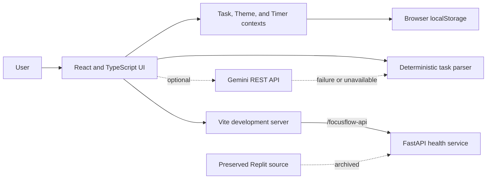

# FocusFlow AI
   

An AI assisted productivity app that turns natural language into scheduled tasks, then helps you follow through with a calendar, focus timer, and task aware assistant. FocusFlow pairs Gemini with an offline deterministic parser so core task commands continue to work without an API key.

## Why FocusFlow

Many productivity tools make quick capture and task organization separate steps. FocusFlow accepts natural language, extracts task details locally, and stores tasks in the browser. Optional Gemini support adds an AI path, while deterministic parsing remains available as a fallback. The project also brings the React/Vite experience together with preserved Replit source and a small FastAPI health service without replacing that original source.

## Features

- React 18, TypeScript, Vite, and Tailwind responsive interface
- Dashboard, Today, All Tasks, Calendar, Focus Timer, and Settings views
- Hybrid task commands: optional Gemini (`gemini-2.5-flash`) plus deterministic offline parsing
- Confirmation before destructive delete actions
- Task search, filters, sorting, categories, priority, due dates, and focus time tracking
- 25 minute focus timer, short and long breaks, and synthesized Web Audio chimes
- Browser localStorage persistence, legacy Replit task migration, and JSON backup/import
- Optional FastAPI health endpoint proxied by Vite during local development

## Architecture



The browser stores the Gemini key locally when the user supplies one. Task parsing, storage, and synthesized audio can run without Gemini. On first load, the storage layer checks the current `focusflow_tasks_v1` key. If it is absent, it can read legacy `focusflow.tasks.v1`, normalize valid task entries, and save migrated entries under the current key. Existing legacy data is retained.

## Requirements

- Node.js 18 or later and npm
- Python 3.13 or later only if you want to run the optional FastAPI service

## Run locally

```powershell
npm ci
npm run dev
```

Open <http://localhost:5173>. For the optional API health endpoint, install its Python dependencies once, then start a second terminal:

```powershell
python -m pip install fastapi uvicorn
npm run dev:api
```

Then check `http://localhost:5173/focusflow-api/healthz`. Vite forwards `/focusflow-api` requests to `http://127.0.0.1:8000` while the development server runs.

Gemini is optional. Add a key through Settings to enable the Gemini path; without it, the deterministic parser remains available.

## Verify

```powershell
npm test
npm run typecheck
npm run build
```

## Project layout

- `src/services/taskEngine.ts`: structured task command parsing and matching
- `src/utils/dateUtils.ts`: date and time extraction
- `src/services/storage.ts`: validated browser persistence, legacy migration, and JSON import/export
- `src/context/`: shared task, theme, and timer state
- `src/components/`: app views and UI components
- `archive/replit/`: preserved Replit source, including the FastAPI backend
- `test-runner.ts`: command safety, storage recovery, and migration checks
- `vite.config.ts`: local API proxy configuration

## GitHub About

**Description:** AI powered productivity app with hybrid Gemini and offline task parsing, calendar, Pomodoro timer, and FastAPI health service.

**Suggested topics:** `productivity`, `react`, `typescript`, `vite`, `fastapi`, `python`, `generative-ai`, `natural-language-processing`, `pomodoro`, `task-management`

## Portfolio bullets

- Built a responsive React and TypeScript productivity app with task search, filtering, an interactive calendar, and a task linked Pomodoro timer.
- Implemented a hybrid natural language task engine using Gemini with deterministic offline parsing, ambiguity handling, and explicit confirmation for destructive actions.
- Added validated localStorage persistence with a backward compatible legacy task migration, JSON backup/import, and a FastAPI health endpoint proxied through Vite.

## License

No license is included in this source package. Add a license file before redistributing the project publicly if you intend to grant reuse rights.


